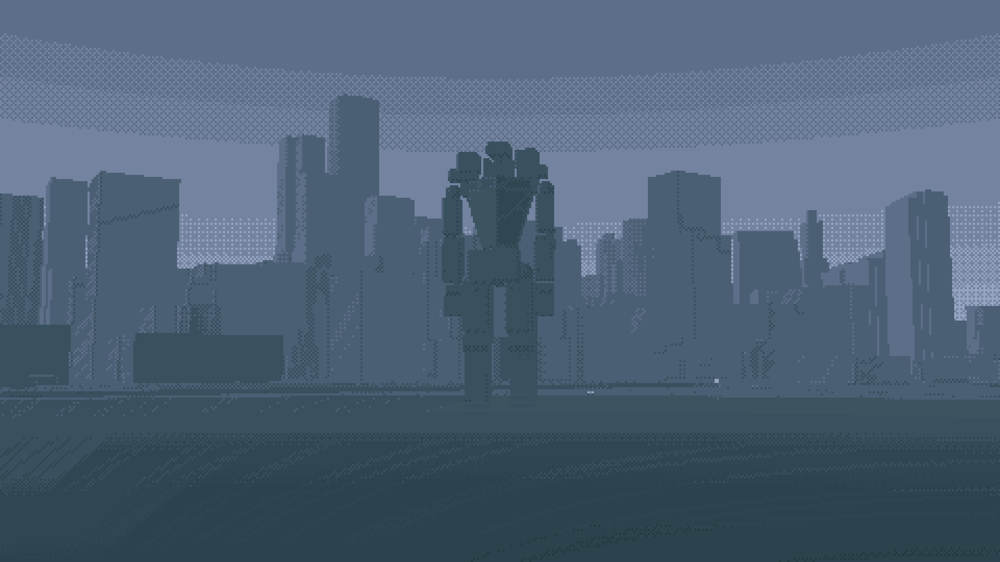

# M0 checkpoint: start here

**Status.** Passed: the pixel pipeline and city tile are merged and working; the style frame places an 80 m mech in 5.48 m of water about 150 m off the Embarcadero, skyline match 0.991, grid and dither checks pass, frame cost is small (0.54 ms CPU p50, 119 draw calls, 0 GC). Failed: the hero's depth-value span is 12.8 L* (needs 15) in 4 of 5 palettes, the waterfront framing fails the same test, the Transamerica tower sits 6.2 px off (limit 3), and screen-anchored dither is not stable in motion. Unmerged: T-005 walking mech (below target pace) and this T-006 packet (on `task/T-006`, under evaluation).

Look at the board for all palettes and framings: [review board](../../evidence/T-006/boards/review_board.png). The wider framing passes the depth test: `M003/M003-12.png`.

## Decisions (default first; say "defaults" to accept all)

1. **Approve the style frame as M0's look?** Default: approve, with the wider framing as hero (the current hero misses the depth-value span). Otherwise: the look stays open and the pipeline/palette work repeats until a framing passes.
2. **Palette profile.** Default: `slate_teal`. Otherwise: another of the five (slate_crimson, warm_rust_sepia, warm_amber_haze, lavender_peach) becomes the base and all captures are redone.
3. **Dither look and anchoring.** Default: dither on, anchored to `direction` (the shipping mode from T-004 cycle 2). Hybrid passes translation but not yaw; screen mode is not stable (Q-060). Otherwise: hybrid or screen need more work before they can ship.
4. **Internal resolution.** Default: 480x270 at 1080p, integer scale 4 (5 at 1440p). Otherwise: a finer grid looks less pixel-art and costs more per frame; a coarser one loses the mech silhouette.
5. **Walk gate (Q-053).** Default: keep T-005 unmerged and approve round 2 with R-008's approach, no assists. Otherwise: merging now ships a walk below target pace (3.07 m/s versus 9 m/s gate), or the gate is relaxed.
6. **Default framing for the first image.** Default: wider. Otherwise: closer also passes depth; the current hero and waterfront do not.
7. **Calibration ratings: now or later?** Default: now, about 40 minutes with the sheets. M-005 (city views) cannot be calibrated yet; the tool supports M-001 to M-004. Otherwise: later, and the style gates stay unconfirmed by human ratings.

## Files

- [GUIDE.md](GUIDE.md): one-page rating guide (read first if rating).
- [sheets/](sheets/): fill these (M-001, M-003, M-004, M-005 CSV; M-003 has 14 rows including hero M003-11 and wider M003-12).
- [captions.md](captions.md): what each blind-named item is. Open `answer_key.json` only after rating.
- [spread.md](spread.md): spread of the packet's items.
- Motion tables per sequence: `../../evidence/T-006/M004_TABLES.md`; depth and dither tables: `../../evidence/T-006/M003_TABLES.md`.
